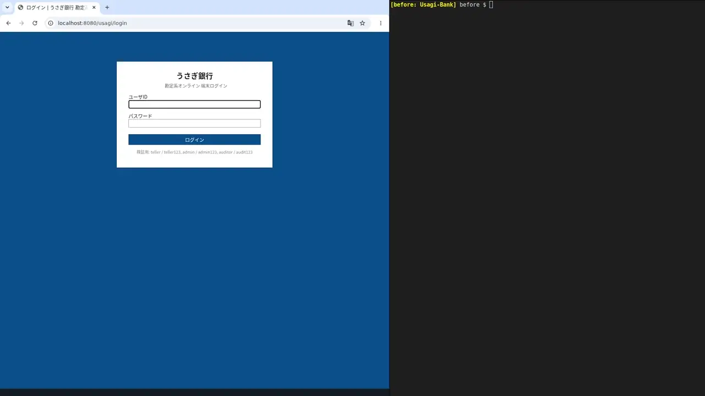
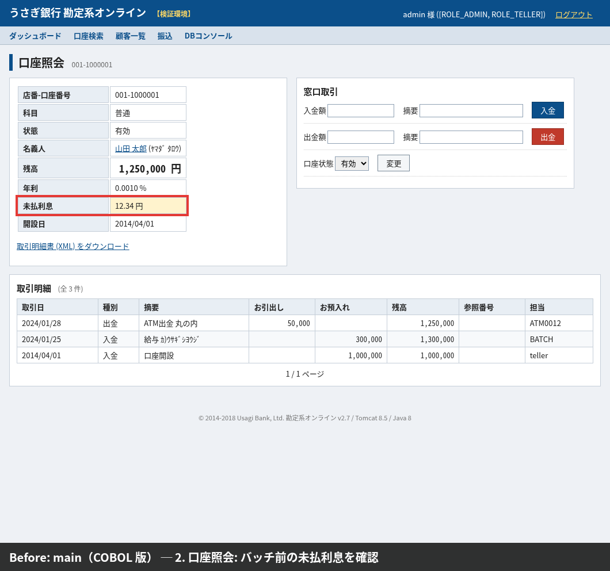
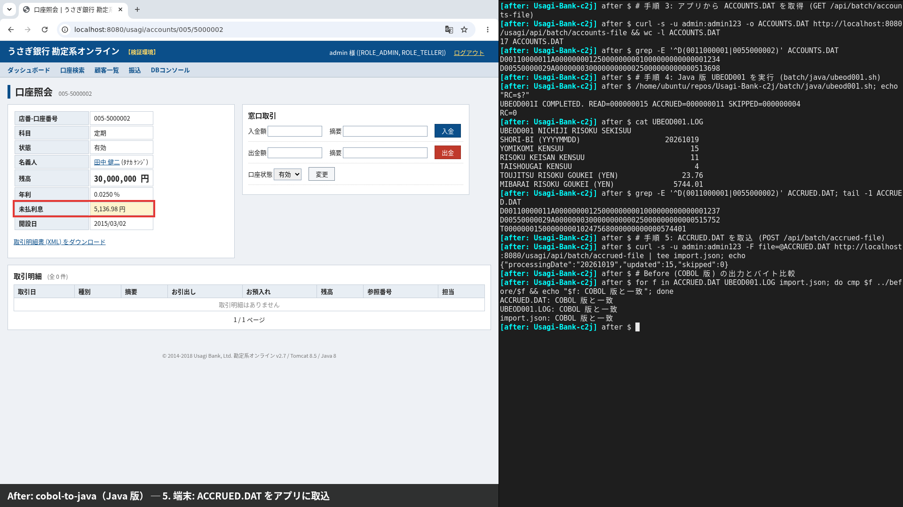
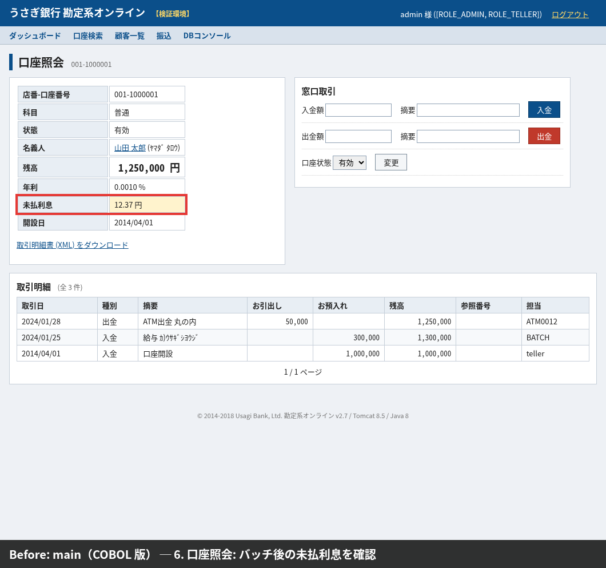
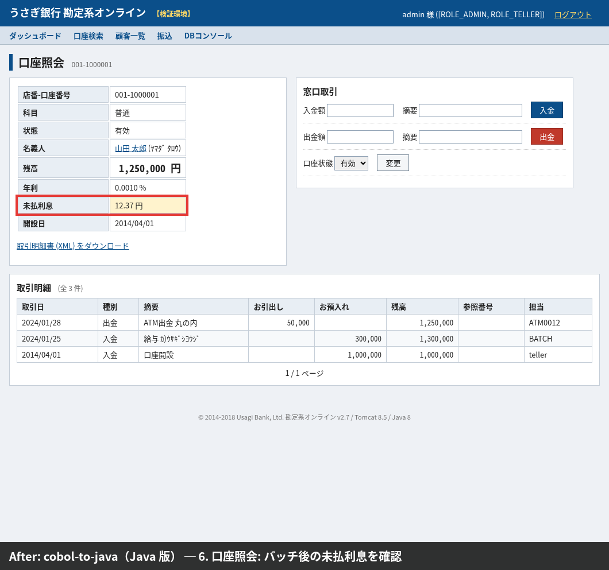
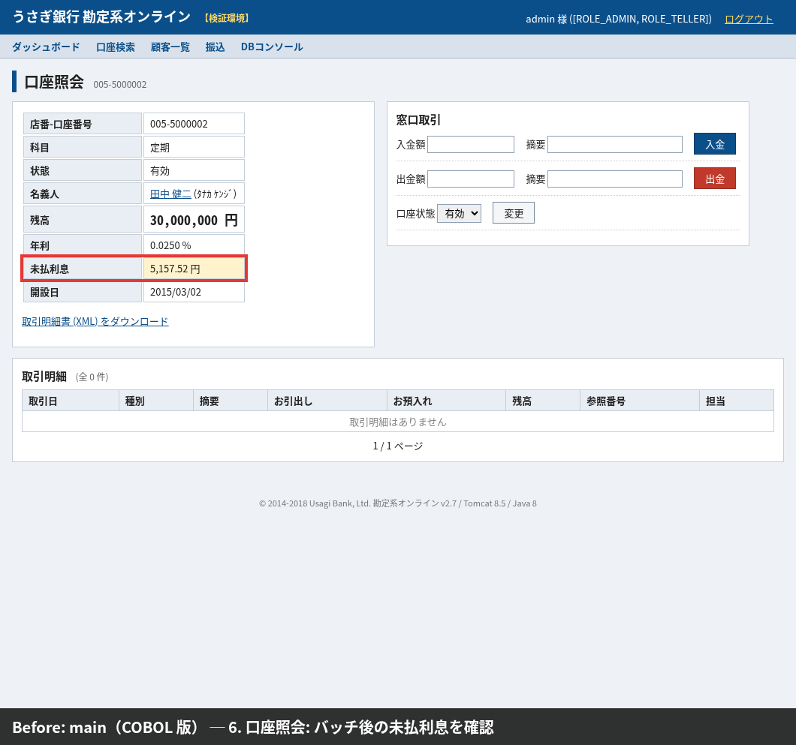
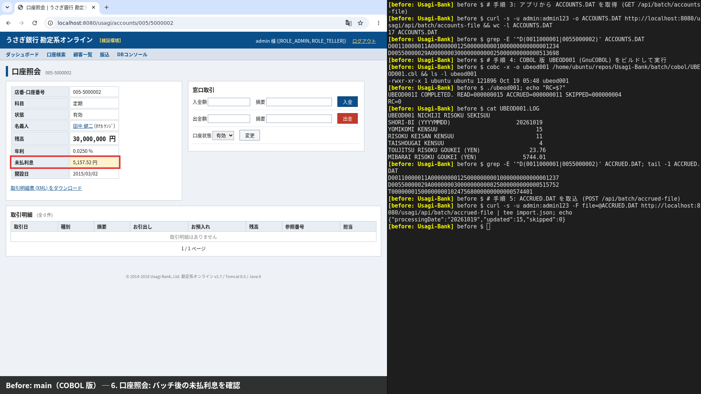
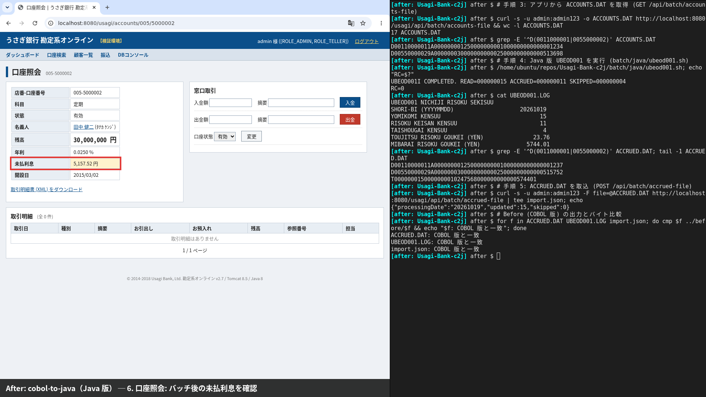

# UBEOD001 ブラウザ E2E: Before (COBOL 版) / After (Java 版)

日次利息積数バッチ UBEOD001 を、画面と端末の両方から新旧同じ手順で動かした録画とスクリーンショット。
画面で見た対象口座の「未払利息」が、COBOL 版 (main) と Java 版 (cobol-to-java) で同じになることを確かめる。

## 結果

| 口座 | バッチ前 (新旧共通) | バッチ後: Before (COBOL 版) | バッチ後: After (Java 版) |
|---|---|---|---|
| 001-1000001 (普通, 1,250,000 円) | 12.34 円 | 12.37 円 | 12.37 円 |
| 005-5000002 (定期, 30,000,000 円) | 5,136.98 円 | 5,157.52 円 | 5,157.52 円 |

- UBEOD001 の結果: RC=0、読込 15・利息計算 11・対象外 4、当日利息合計 23.76 円 (新旧同じ)
- 取込結果: `{"processingDate":"20261019","updated":15,"skipped":0}` (新旧同じ)
- After の最後に `cmp` で ACCRUED.DAT・UBEOD001.LOG・取込応答 (import.json) が Before とバイト一致することを確認

## 録画

| Before: main (COBOL 版) | After: cobol-to-java (Java 版) |
|---|---|
|  |  |

左がブラウザ、右が端末。画面下の帯に版と手順を出している。各 80 秒ほど。

## スクリーンショット

| | Before (COBOL 版) | After (Java 版) |
|---|---|---|
| バッチ前 001-1000001 |  |  |
| バッチ前 005-5000002 |  |  |
| 端末 (取得・バッチ・取込) |  |  |
| バッチ後 001-1000001 |  |  |
| バッチ後 005-5000002 |  |  |
| 最終画面 (ブラウザ + 端末) |  |  |

## 手順

どちらもアプリを起動し直した直後 (H2 は初期化され、未払利息は初期データの値) から始める。

1. ブラウザで `http://localhost:8080/usagi/login` に admin / admin123 でログイン
2. 口座検索 → 001-1000001、005-5000002 の口座照会で「未払利息」を確認 (赤枠)
3. 端末: アプリから ACCOUNTS.DAT を取得
   `curl -s -u admin:admin123 -o ACCOUNTS.DAT http://localhost:8080/usagi/api/batch/accounts-file`
4. 端末: UBEOD001 を実行 (カレントディレクトリの ACCOUNTS.DAT → ACCRUED.DAT・UBEOD001.LOG)
   - Before: `cobc -x -o ubeod001 <main>/batch/cobol/UBEOD001.cbl && ./ubeod001`
   - After: `<cobol-to-java>/batch/java/ubeod001.sh`
5. 端末: ACCRUED.DAT をアプリに取込
   `curl -s -u admin:admin123 -F file=@ACCRUED.DAT http://localhost:8080/usagi/api/batch/accrued-file`
6. ブラウザで同じ 2 口座の口座照会を開き直し、未払利息が増えたことを確認
7. (After のみ) `cmp` で ACCRUED.DAT・UBEOD001.LOG・取込応答を Before と比較

画面にファイル取得・取込の機能はないので、手順 3〜5 は端末で行う (`batch/golden/integration.sh` と同じ API 経路)。
`batch/cobol/run.sh` / `batch/java/run.sh` は使っていない。両方とも固定の期待値 (処理日 20180315) と比べるため、
API から取ったファイル (処理日 = 当日) では結果が正しくても GOLDEN MISMATCH を出して見づらいので、
COBOL 版は cobc で作った実行ファイルを、Java 版は `batch/java/ubeod001.sh` を直接実行した。

### 録画のやり直し

```sh
# 前提: JDK 8, Maven, cobc, Xvfb, xterm, xdotool, xclip, ffmpeg, Noto Sans CJK, pip install playwright
# main を ~/repos/Usagi-Bank (BEFORE_REPO で変更可) にチェックアウトし、ポート 8080 を空けておく
python3 docs/migration/e2e/record.py before   # main (COBOL 版)
python3 docs/migration/e2e/record.py after    # このブランチ (Java 版)。cmp のため before を同じ日に先に録る
```

仮想ディスプレイ :99 にブラウザと xterm を並べて ffmpeg で録画する。mp4 と作業ファイルは `~/e2e/<before|after>/`、
スクリーンショットは `docs/migration/e2e/screenshots/` に出る。PR 用の webp は
`ffmpeg -i before.mp4 -vf "fps=6,scale=1280:-2" -loop 0 -quality 60 before.webp` で作った。
処理日はアプリの業務日付 (当日) なので、別の日に録り直すとバッチ後の値は同じでもヘッダの処理日は変わる。

## レビューで確認すること

- [ ] 2 本の録画で、バッチ前の未払利息が同じ (12.34 円 / 5,136.98 円)
- [ ] バッチ後の未払利息が新旧で同じ (12.37 円 / 5,157.52 円)
- [ ] 端末で Before は COBOL (cobc + ./ubeod001)、After は Java (`batch/java/ubeod001.sh`) を実行している
- [ ] 両方 RC=0、UBEOD001.LOG の件数・合計が同じ、取込は updated 15 / skipped 0
- [ ] After の最後の `cmp` で 3 ファイルとも「COBOL 版と一致」
